<div align="center">

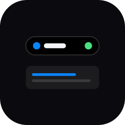

# NotchDeck

**macOS 与 Windows 通用的桌面灵动岛**

平时收起在屏幕顶部（或底部、左右边缘），鼠标移上去展开：AI 编程工具额度、消息提醒、文件中转、快捷翻译、日程、音乐与歌词、系统监控、设备电量、待办、番茄钟、饮水、剪贴板和天气都在这一座小岛上。

基于 Tauri 2 + React + Rust，原生、轻量。

[官网](https://fangkyi03.github.io/notchdeck/) · [使用说明](https://fangkyi03.github.io/notchdeck/guide.html) · [下载](https://github.com/fangkyi03/notchdeck/releases/latest)

</div>

<p align="center">
  
</p>

<p align="center">
  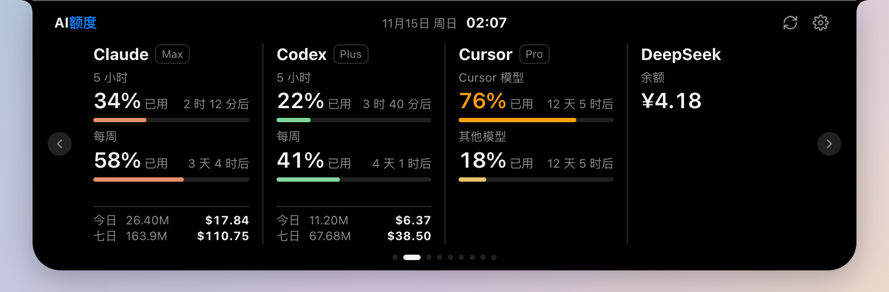
</p>

## 功能

### 收起形态

| 刘海（贴顶） | 胶囊（悬浮）+ 单行歌词 | 指示条 | 侧边竖向 |
| :---: | :---: | :---: | :---: |
|  |  |  | 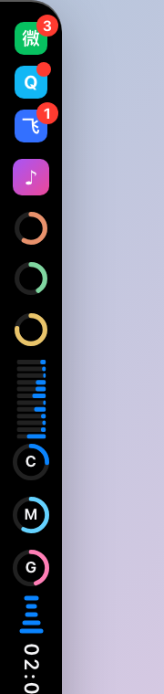 |

- 三种形态：**刘海**带内凹肩膀贴住屏幕边缘；**胶囊**悬浮；**指示条**平时只是一条细线，悬停展开。
- **可拖动**：沿顶边左右移动；拖离顶边变悬浮胶囊；拖到屏幕**底边**贴底（面板向上展开）；拖到**左 / 右边缘**自动变成**竖向胶囊**，面板从侧边展开。
- **多显示器**：可以直接拖到另一块屏幕（不同分辨率、不同缩放比例都能对齐），也可以在设置中指定。
- 收起内容可自选并**拖动排序**：消息未读、文件中转数量、下一个日程、饮水进度、设备电量、专辑封面、AI 额度环（单环 / 多环、已用 / 剩余）、CPU 核心柱、CPU / 内存 / GPU 表盘、网速、歌词、律动条、时间、天气、专注倒计时、待办进度。
- 宽度随内容自适应，数字变化时不会来回跳动。
- 额度用到 70% / 90%、有新消息、会议快开始、该喝水了、番茄钟结束时，在岛上提示。
- **系统状态提示**：调节音量、切换大写锁定或输入法、网络断开 / 恢复、充电插拔与低电量、无线设备电量低时，在岛上短暂显示。
- **闲置贴边隐藏**：一段时间不操作缩成一条细线，鼠标移上去恢复。
- **全屏自动隐藏**、**游戏模式**（鼠标穿透，只能用快捷键打开）。

### 展开页面

展开后用左右箭头、滚轮、← → 键或底部圆点切换；页面可在设置中开关、排序。拖动面板左右和底部边缘可调整大小。

| | |
| :---: | :---: |
| 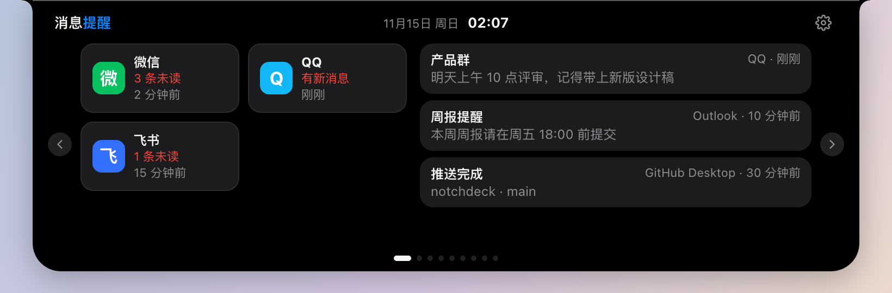<br>**消息提醒** | 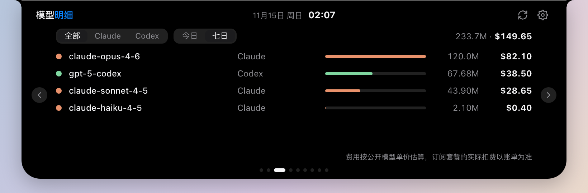<br>**模型明细** |
| 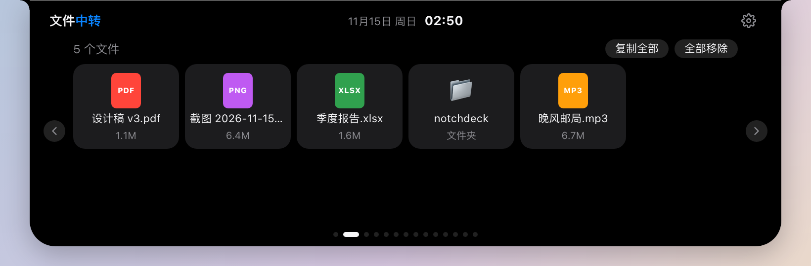<br>**文件中转** | 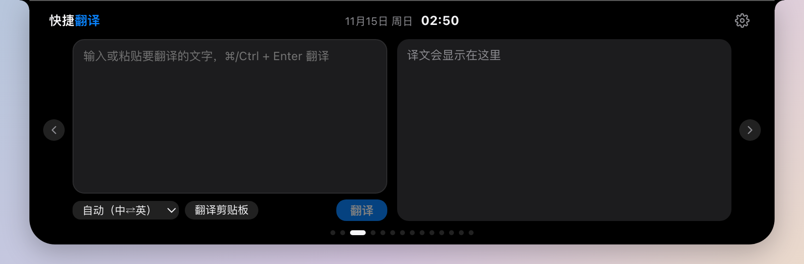<br>**快捷翻译** |
| 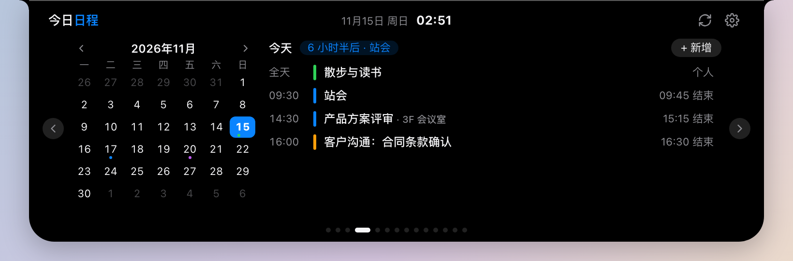<br>**日程** | 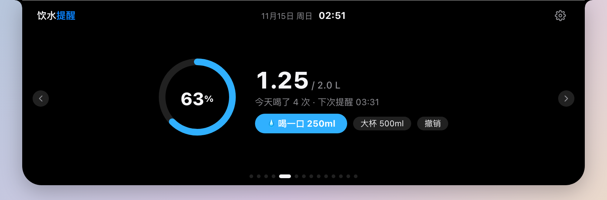<br>**饮水提醒** |
| 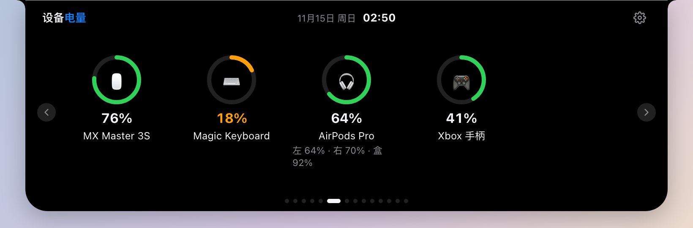<br>**设备电量** | 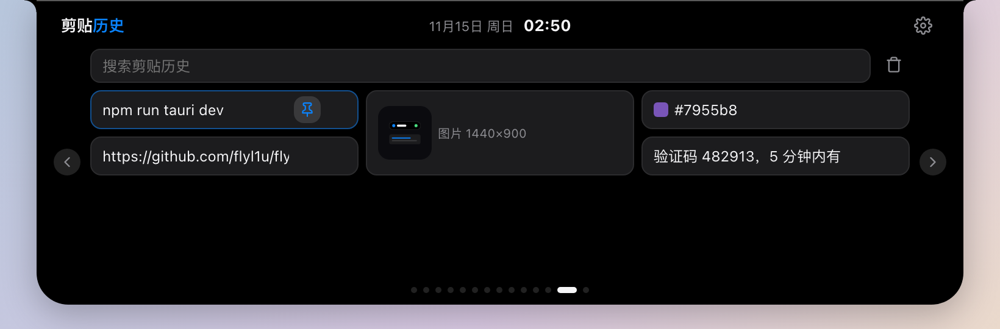<br>**剪贴板（文字与图片）** |
| 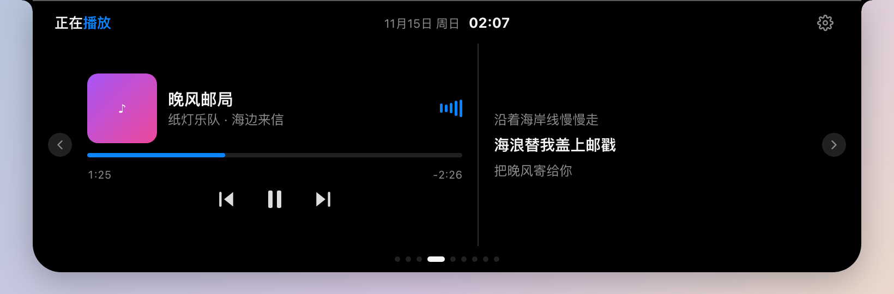<br>**音乐与歌词** | 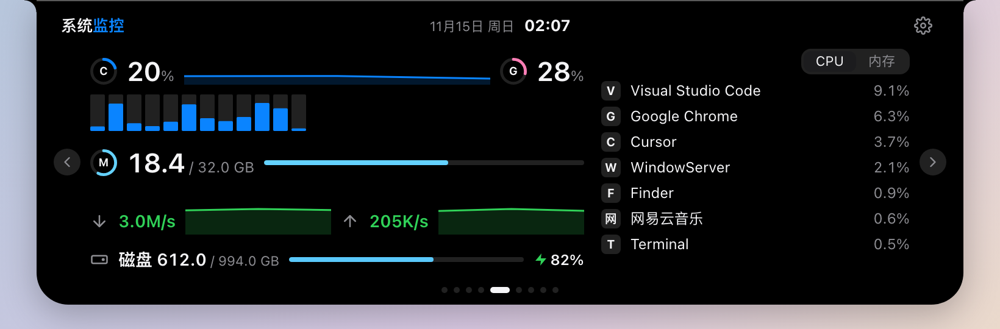<br>**系统监控** |
| 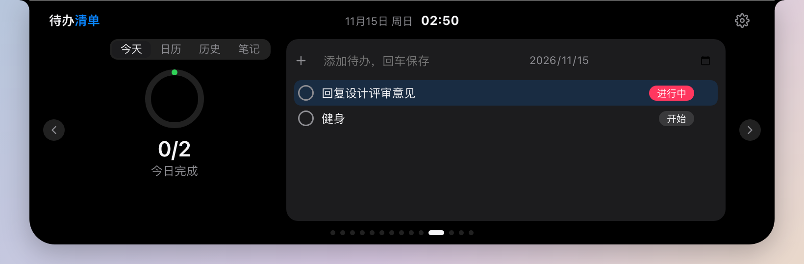<br>**待办** | 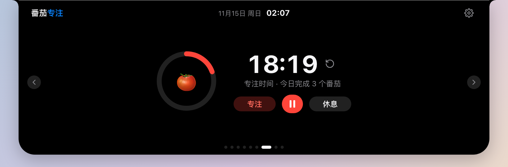<br>**番茄专注** |
| 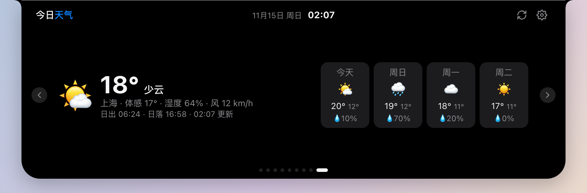<br>**天气** | |

**AI 额度**：每个工具一列，显示套餐、5 小时 / 每周额度的已用比例和重置倒计时，底部是今日 / 七日的 Token 与费用估算。

| 来源 | 额度 | Token 与费用 | 说明 |
| --- | :---: | :---: | --- |
| Claude | ✓ | ✓ | 使用本机 Claude Code 的登录读取额度；用量来自 `~/.claude/projects` 会话记录 |
| Codex | ✓ | ✓ | 读取 `~/.codex/sessions` 中的额度快照与用量 |
| Cursor（实验性） | ✓ | | 读取本机 Cursor 的登录，显示本月额度与按量计费 |
| Antigravity（实验性） | ✓ | | 需要桌面版正在运行，读取各模型额度 |
| 智谱 GLM / Z.ai | ✓ | | Coding Plan 的 5 小时、每周额度与工具调用（填写 API Key） |
| Kimi Code | ✓ | | 5 小时与每周 / 每月额度（填写 `sk-kimi-` API Key） |
| DeepSeek | ✓ | | 账户余额、赠送余额（填写 API Key） |
| OpenRouter | ✓ | | 账户余额、密钥额度、今日扣费（填写 API Key） |
| Kimi（Moonshot 开放平台） | ✓ | | 可用余额、代金券（填写 API Key） |
| 自定义命令 / HTTP | ✓ | | 命令输出 JSON，或 HTTP 接口 + 字段路径 |

费用按公开模型单价估算，订阅套餐的实际扣费以账单为准。API Key 保存在系统钥匙串（macOS Keychain / Windows 凭据管理器），不写入配置文件。

**音乐**：封面、歌名、歌手与专辑、进度条（可拖动跳转）、播放控制，以及来自 [LRCLIB](https://lrclib.net) 的同步歌词；收起时可只显示当前一句歌词。

**系统监控**：CPU 总占用与每核心、GPU、内存、上下行网速曲线、硬盘、电池，按 CPU 或内存排序的进程列表；每项颜色可自定义。

**文件中转**：把文件拖到小岛上暂存（只记录路径，不复制文件），之后双击打开、在访达 / 资源管理器中显示、复制文件（直接粘贴到聊天或文件夹），或者再从岛上**拖出去**放到别的应用里。

**快捷翻译**：支持 DeepSeek、Kimi、通义千问、硅基流动、火山方舟、OpenAI 及任意 OpenAI 兼容接口；快捷键 <kbd>⌘/Ctrl ⇧ T</kbd> 直接翻译剪贴板里最新的文字，自动判断中英方向。

**日程**：订阅 ICS 链接（iCloud、Google、飞书、钉钉、企业微信、Outlook）、连接 CalDAV 账户（自动发现日历，iCloud 用 App 专用密码）或导入 `.ics` 文件；支持重复日程与时区，会议开始前提醒，也可以新增本机日程。

**待办**：今天 / 日历 / 历史 / 笔记四个视图，待办可以安排到以后的某一天，每天一页笔记。

**饮水提醒**：每日目标、每次饮水量、提醒间隔与时段，一键记录、可撤销。

**设备电量**：无线鼠标、键盘、耳机、手柄的电量，AirPods 分别显示左右耳与充电盒；电量低时变色并提醒。

**剪贴板**：记录复制过的文字和图片（截图也会记录），点一下放回剪贴板，可置顶、搜索。

### 皮肤

经典黑、奶油、毛玻璃·浅、毛玻璃·深、One Dark Pro、Dracula、Night Owl、GitHub Light、赛博朋克，以及自定义配色；可调整大小（80%–140%）和背景不透明度。

| | |
| :---: | :---: |
| 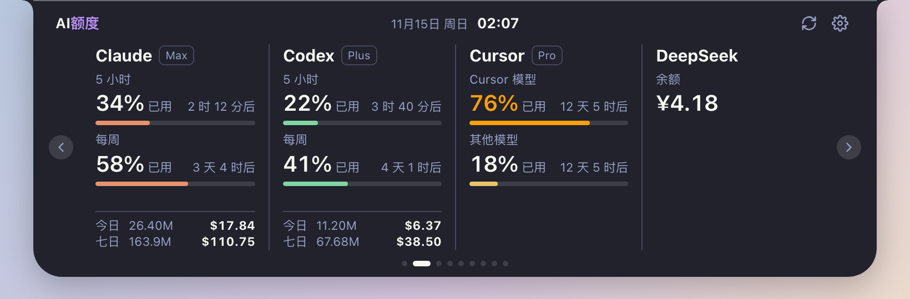<br>Dracula | 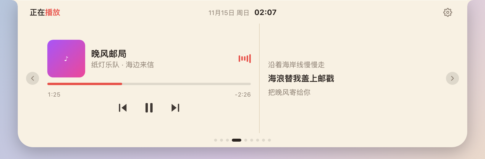<br>奶油 |
| 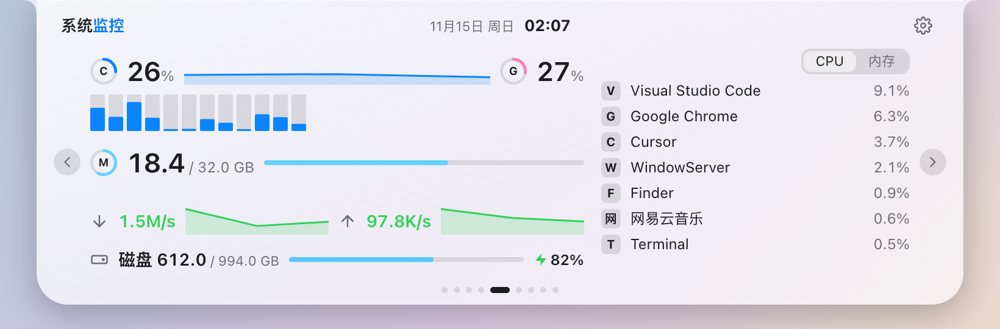<br>毛玻璃 · 浅 | 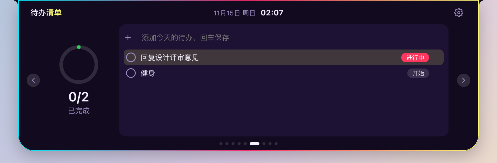<br>赛博朋克 |

### 设置

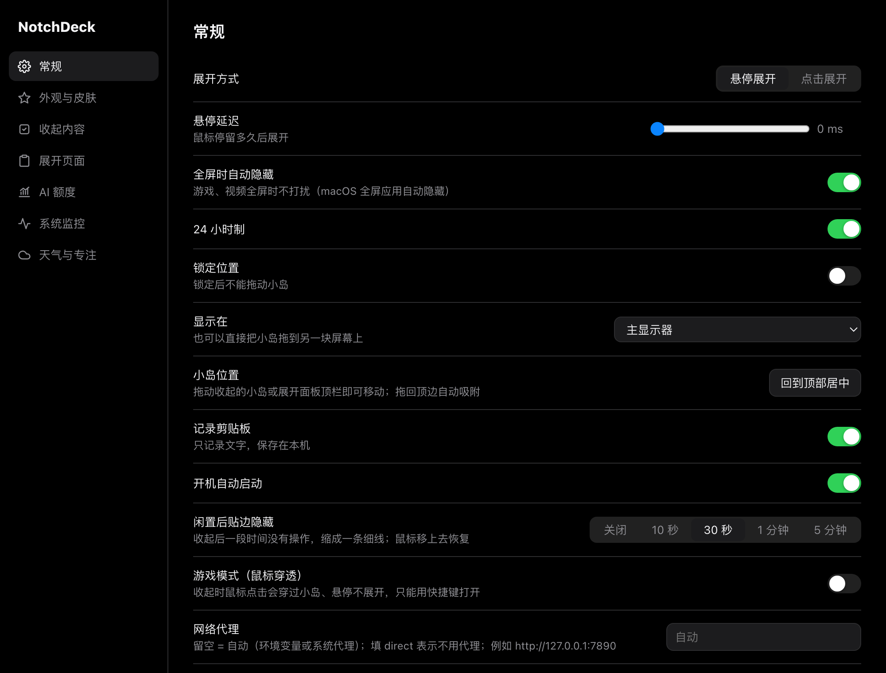

开机自启、全局快捷键（展开 / 收起、打开剪贴板、打开待办）、网络代理、显示器选择等都在设置窗口中，点击展开面板右上角的齿轮或托盘图标打开。

## 平台差异

两个平台的功能分开实现，各自使用本平台能用的机制，不因为另一个平台不支持就去掉。

| 功能 | macOS | Windows |
| --- | --- | --- |
| 设备电量 | Apple 键盘 / 鼠标 / 触控板（ioreg）、AirPods 等耳机（system_profiler）；不向系统报告电量的第三方蓝牙设备暂不支持 | 蓝牙设备电量属性（设置 › 蓝牙和设备中能看到电量的设备） |
| 大写锁定 / 输入法 | CoreGraphics / TIS 输入源 | GetKeyState / 键盘布局与输入法中英状态 |
| 音量 | 系统音量设置 | Core Audio 终结点音量 |
| 复制文件 | AppleScript | PowerShell `Set-Clipboard -Path` |
| 消息提醒 | 读取 Dock 图标未读数（`lsappinfo`）：微信、QQ、企业微信、钉钉、飞书、邮件、Telegram、Slack | 监听任务栏闪烁（Shell Hook）提醒上述应用；另读取系统通知中心的通知（需在系统设置中允许通知访问） |
| 正在播放 | Spotify、Apple Music（AppleScript） | 系统媒体会话 SMTC：网易云音乐、QQ 音乐、酷狗、Spotify、浏览器等 |
| GPU 占用 | IOAccelerator | PDH 性能计数器（3D 引擎） |
| 全屏隐藏 | 小岛不进入全屏应用所在的空间 | 检测前台窗口是否覆盖整个显示器 |
| 盖住菜单栏 | 窗口层级高于菜单栏 | — |
| 系统代理 | `scutil --proxy` | Internet 设置（注册表） |

> 说明：Windows 版目前只在 macOS 上通过交叉编译做过类型检查（`scripts/check-windows.sh`），尚未在 Windows 真机上完整测试，欢迎反馈。

## 安装与运行

需要 [Rust](https://rustup.rs)、Node.js 18+，以及 Tauri 的[系统依赖](https://tauri.app/start/prerequisites/)（Windows 需要 WebView2 与 MSVC 构建工具）。

```bash
npm install
npm run tauri dev      # 开发运行
npm run tauri build    # 打包安装包
```

首次运行时：

- **macOS**：第一次读取 Claude 额度时，系统会询问是否允许访问钥匙串中的「Claude Code-credentials」，选择允许即可；读取 Apple Music 时会询问自动化权限。
- **Windows**：如需读取通知中心的通知，在「设置 › 隐私和安全性 › 通知」中允许应用访问通知。
- 如果你所在的网络需要代理才能访问 Anthropic 等服务，NotchDeck 会自动使用 `HTTPS_PROXY` 环境变量或系统代理，也可以在设置 › 常规 › 网络代理中手动填写。

### 界面预览（不需要 Rust）

`preview.html` 用模拟数据渲染整个界面，方便调样式：

```bash
npm run dev
# 浏览器打开：
# http://localhost:1420/preview.html?page=ai&expand=1
# http://localhost:1420/preview.html?skin=cream&shape=capsule
# http://localhost:1420/preview.html?dock=left
# http://localhost:1420/preview-settings.html
```

README 中的截图都由这个预览页生成。

### 在 macOS 上检查 Windows 代码

```bash
rustup target add x86_64-pc-windows-msvc
./scripts/check-windows.sh
```

## 数据与隐私

- 设置、待办、笔记、日程、剪贴板历史（含图片）、文件中转列表保存在本机配置目录（macOS `~/Library/Application Support/NotchDeck`，Windows `%APPDATA%\NotchDeck`）。
- API Key、CalDAV 密码保存在系统钥匙串 / 凭据管理器中。
- 文件中转只记录文件路径，不复制文件；翻译时原文会发送到你选择的翻译服务。
- Claude 登录令牌只在内存中用于请求额度接口，不写入磁盘，也不会续期或修改登录。
- 消息提醒不读取聊天内容：macOS 只读未读数字；Windows 只记录任务栏闪烁，以及你允许访问的系统通知。
- 联网只用于：读取 AI 额度、查询歌词（LRCLIB）、天气（Open-Meteo）与自动定位（ipwho.is）、同步你添加的日历、翻译、检查更新。

## 项目结构

```
src/
  island/        小岛：收起内容、展开面板、各个页面
  settings/      设置窗口
  lib/           类型、皮肤、格式化、图标、Tauri 调用
  preview/       浏览器预览用的模拟数据
src-tauri/src/
  geom.rs        多显示器定位、拖动吸附（顶部 / 左 / 右）
  usage.rs       AI 额度与 Token 统计
  messages.rs    消息提醒（macOS / Windows 各一套）
  devices.rs     设备电量与系统状态提示（macOS / Windows 各一套）
  calendar.rs    ICS / CalDAV 日历与重复日程
  shelf.rs       文件中转
  translate.rs   OpenAI 兼容接口翻译
  media.rs       正在播放、歌词
  sysmon.rs      系统监控
  runtime.rs     开机自启、全局快捷键、鼠标穿透
  net.rs         代理感知的 HTTP
  extras.rs      剪贴板、天气、本地存储
```

## 自动更新

应用会在启动后和之后每天检查 GitHub Releases 上的新版本，在 设置 › 关于与更新 中一键下载、安装并重启。更新包经过 Tauri updater 签名校验。

发布者需要在仓库的 Actions secrets 中配置 `TAURI_SIGNING_PRIVATE_KEY` 与 `TAURI_SIGNING_PRIVATE_KEY_PASSWORD`（用 `npx tauri signer generate` 生成，公钥写在 `src-tauri/tauri.conf.json`）；未配置时 Release 仍会构建安装包，只是不带自动更新文件。本地 `npm run tauri build` 同样需要这两个环境变量。

## 路线图

- [ ] 邮箱（IMAP）与验证码识别
- [ ] 第三方蓝牙设备电量（通过 CoreBluetooth 读取电池服务）
- [ ] 更多播放器的精准进度与歌词适配
- [ ] 多语言界面

## 致谢

设计与功能参考了这些优秀的开源项目（只参考设计，未使用其代码）：

- [BrimDeck](https://github.com/MoFeng2223/BrimDeck)：AI 额度面板、系统监控与主题
- [fly-island](https://github.com/flyl1u/fly-island)：灵动岛交互、待办与剪贴板
- [岛仔 Daozai](https://github.com/Renly1994/xiaotang-daozai)：皮肤、侧边停靠、番茄专注与天气

歌词来自 [LRCLIB](https://lrclib.net)，天气来自 [Open-Meteo](https://open-meteo.com)。
